<p align="center">
  <a href="https://furkiozknn.github.io/mehter/"></a>
</p>

<p align="center">
  <a href="https://furkiozknn.github.io/mehter/"></a>
  
  
  <a href="LICENSE"></a>
  
</p>

<p align="center"><b>A 3D rhythm march down an old Ottoman parade avenue: the mehter band walks towards you while notes roll down four lanes for the davul, kös, zurna and zil. Hit them on the beat and keep the band's spirit up.</b></p>

<p align="center">
  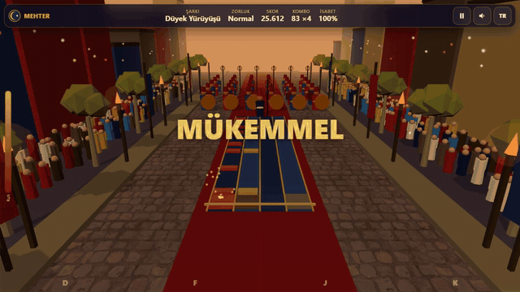
  <br>
  <sub>Watch the promo: <a href="https://github.com/Furkiozknn/social-videos/releases/download/promo-2026-10/2026-10-28-mehter-en.mp4">EN</a> · <a href="https://github.com/Furkiozknn/social-videos/releases/download/promo-2026-10/2026-10-28-mehter-tr.mp4">TR</a></sub>
</p>

<p align="center"><b>Play online: <a href="https://furkiozknn.github.io/mehter/">https://furkiozknn.github.io/mehter/</a></b> (desktop and phone, no install)</p>

## Highlights

- **A whole band in front of you.** Kös and davul drummers, zurna players, a çevgen bearer and the mehterbaşı march
  towards the camera down a torch-lit avenue lined with plane trees and a cheering crowd.
- **Four lanes, four instruments.** Davul, kös, zurna and zil on `D` `F` `J` `K` (rebindable) or four touch zones; long
  zurna notes have to be held to the end.
- **Six songs in three difficulties.** From Düyek March at 96 BPM to March of Victory at 176 BPM, each in Easy, Normal and
  Hard; harder charts add notes from the same rhythm patterns, so every chart matches the music.
- **Timing you can trust.** Music is synthesised and scheduled on the audio clock, hits are judged against that clock,
  and a calibration screen measures your input offset.
- **Played by a bot.** The `?auto` bot plays all six songs; on the last one it hit all 907 notes perfectly for an S grade,
  with and without the optional assets.
- **Light on a laptop GPU.** 61 fps (the display cap) on an Intel UHD GPU at 1280x720 with 29 draw calls, before and
  after the asset pass ([measurements](docs/assets.md)).
- **One file, made in code.** One `index.html` with Three.js r170 from a CDN; the world, the band, the songs and the
  music are generated in code, with an optional CC0 asset pass loaded on top.

## How to play

> [!TIP]
> **Goal:** hit the notes on the beat and keep the band's spirit above zero until the end of the song. A clean run earns
> an S grade.

Notes roll towards the hit line on the road in front of the band. Press the lane key when a note reaches the line:
**Perfect** within 45 ms, **Good** within 110 ms, otherwise a miss. Zurna notes are long: press, then hold until the end
of the note.

<details>
<summary><b>More rules</b></summary>

- Releasing a zurna note too early breaks it.
- Combos raise the score multiplier: x2 at 10, x3 at 25, x4 at 50.
- Band spirit drops on misses and rises on hits. At zero the song ends.
- Results show a grade (S, A, B, C), a hit-timing histogram and your best score per song and difficulty.
- **Calibration:** open Calibration from the title screen, press Start and tap a key or the Tap button on each
  metronome beat. The median offset is saved and subtracted from every hit judgement.

</details>

### Controls

| Action | Mouse / touch | Keyboard |
|---|---|---|
| Lanes (davul, kös, zurna, zil) | tap the four lane zones at the bottom | `D` `F` `J` `K` (rebindable in Settings) |
| Pause / back | pause button | `P` / `Esc` |
| Music / effects | sound settings | `M` / `X` |
| Language | TR / EN button | `L` |
| Fullscreen | settings | |

Settings (volumes, TR / EN, Low / High quality, key bindings and the calibration offset) are saved in `localStorage`
under `arena.mehter.settings`; best results under `arena.mehter.best`. Turkish is the default language; phones start on
the Low tier.

<details>
<summary><b>URL flags for testing</b></summary>

| Flag | Effect |
|---|---|
| `?auto` | the bot plays through all six songs (Normal) to the end |
| `?debug` | draw calls, fps, triangles, state and JS errors on screen |
| `?sim=N` | fast-forward N seconds of song time before the first frame, without rendering |
| `?low` | shadows off, half the particles |
| `?noassets` | skip the CC0 asset files and keep the procedural world and synthesised sounds |
| `?lang=en` / `?lang=tr` | language |
| `?song=N` | song index (0-5) for `?auto` and `?sim` |
| `?screen=…` | open `settings`, `pause`, `select`, `calib` or `results` directly (for screenshots) |

In the browser console, `window.mehter.state()` returns the live state (including which assets loaded) and
`window.mehterSim(seconds)` fast-forwards the current song.

</details>

## Screenshots

<table>
  <tr>
    <td width="33%">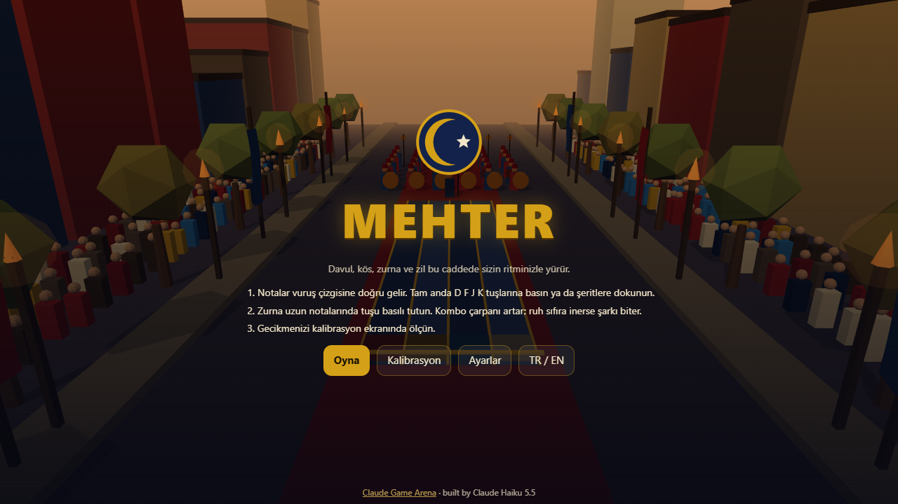<br><sub>Title screen</sub></td>
    <td width="33%">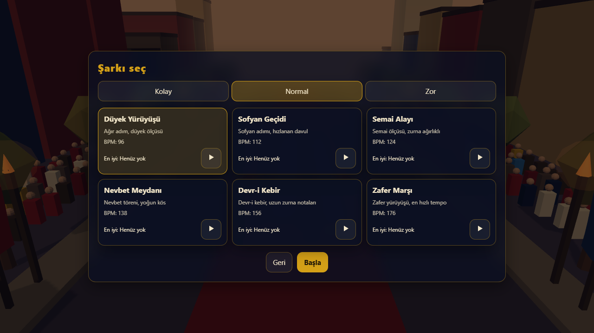<br><sub>Song select</sub></td>
    <td width="33%">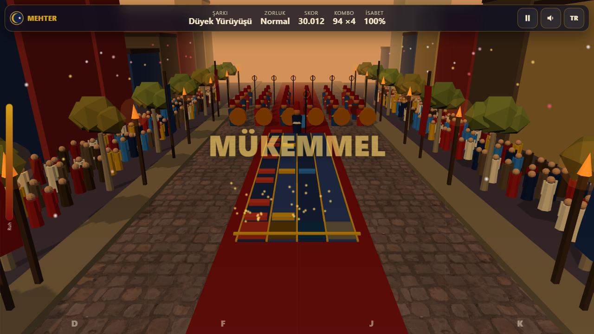<br><sub>The band on the cobbled avenue</sub></td>
  </tr>
  <tr>
    <td>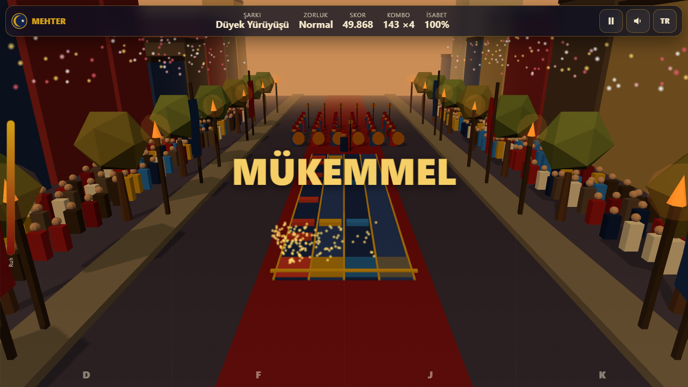<br><sub>A perfect hit</sub></td>
    <td>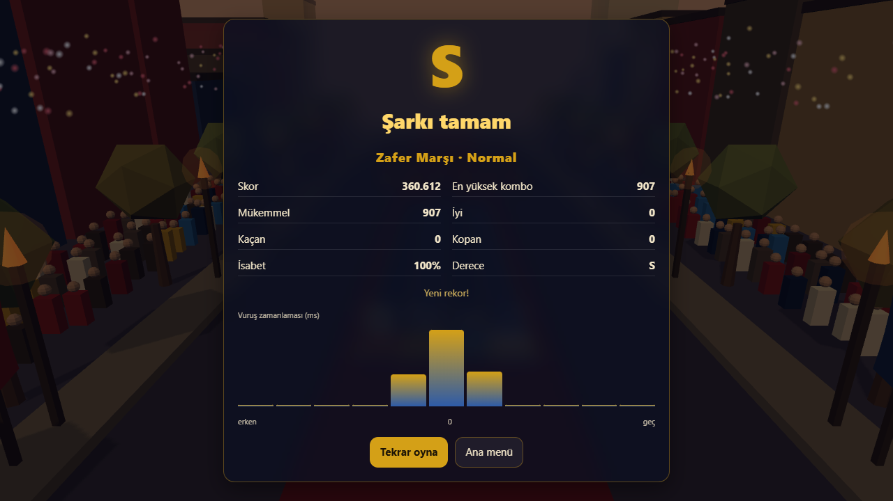<br><sub>S grade, 907 of 907 perfect</sub></td>
    <td>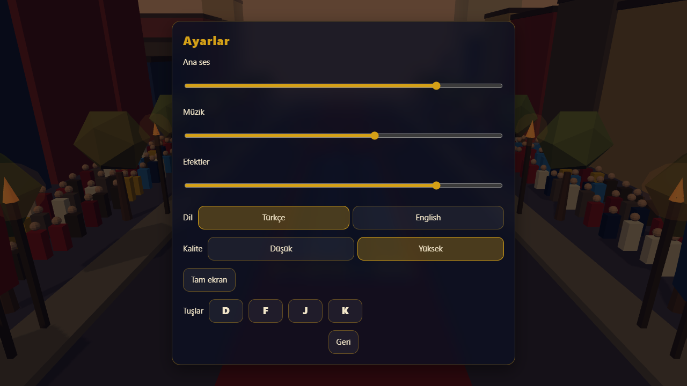<br><sub>Settings</sub></td>
  </tr>
</table>

<details>
<summary><b>Phone layout and the asset pass, before and after</b></summary>

<table>
  <tr>
    <td width="50%">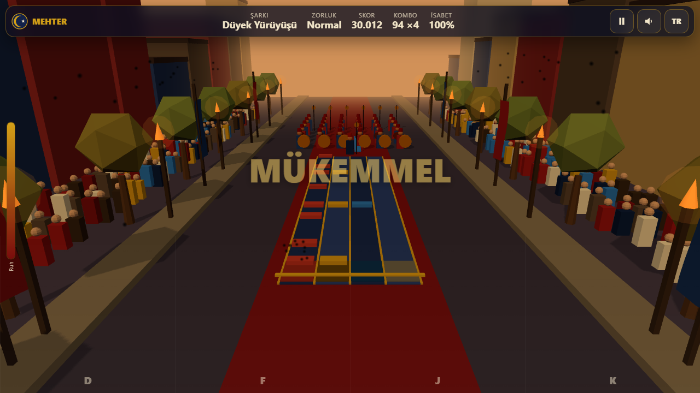<br><sub>Avenue, procedural</sub></td>
    <td width="50%"><br><sub>Avenue, with the asset pass</sub></td>
  </tr>
  <tr>
    <td>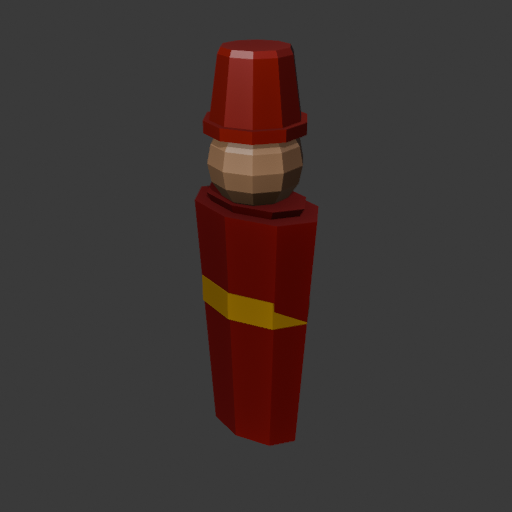<br><sub>Band figure model</sub></td>
    <td>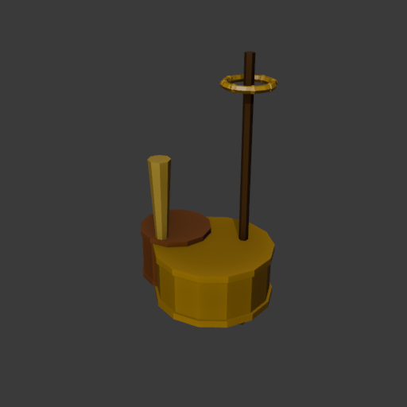<br><sub>Instrument models</sub></td>
  </tr>
</table>

<p align="center">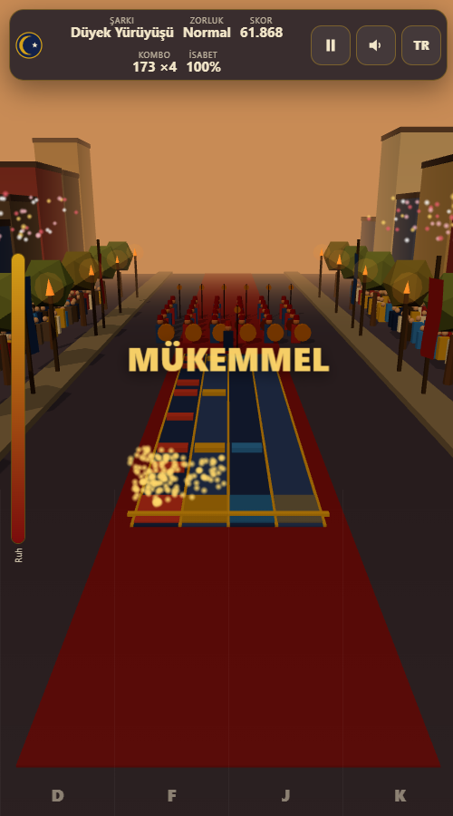<br><sub>On a phone</sub></p>

</details>

## Balance

The songs are generated in code from usul rhythm patterns (düyek, sofyan, semai, nevbet, devr and zafer). The bot run
`?auto&sim=99999` plays all six songs without rendering: on the last song all 907 notes were perfect, grade S, with 0 JS
errors, both with the assets and with `?noassets` ([bot run](docs/assets.md#numbers)).

## Running locally

Serve the folder over HTTP (browsers block some features on `file://`):

```
python -m http.server 8000
```

then open <http://localhost:8000/>.

## How it was made

Built by **Claude Haiku 5.5** with Claude Code from one prompt: [prompts/mehter.md](prompts/mehter.md); the shared arena
rules were appended to that prompt. The avenue, crowd, trees, torches and notes are instanced or merged low-poly geometry
with vertex colours, and the music, hit sounds and crowd cheers are synthesised with the Web Audio API.

An optional asset pass (about 1.75 MB, most of it the HDRI) adds Blender-built band figures (kaftan, sash, tall börk) and
instruments (davul, kös, zurna, çevgen), a Poly Haven cobblestone texture for the road, a dusk HDRI on the High tier, and
two Kenney sounds (a UI click and the results fanfare). They load after the first frame and the procedural versions stay
as the fallback (`?noassets` skips them). Licences: [CREDITS.md](CREDITS.md); file list, sizes and fps before and after:
[docs/assets.md](docs/assets.md). Model scripts: `assets/src/`.

Mehter is part of the **Claude Game Arena** series, where each game is built by a Claude model from one prompt. The
other games: [Hisar](https://furkiozknn.github.io/kale-savunmasi/) ·
[Çay Ocağı](https://furkiozknn.github.io/cay-ocagi/) · [Çini Ustası](https://furkiozknn.github.io/cini-ustasi/) ·
[Martı](https://furkiozknn.github.io/marti/) · [Kervan](https://furkiozknn.github.io/kervan/) ·
[Dolmuş](https://furkiozknn.github.io/dolmus/) · [Peri Golf](https://furkiozknn.github.io/peri-golf/) ·
[Boğaz Vapuru](https://furkiozknn.github.io/bogaz-vapuru/) · [Simit Fırını](https://furkiozknn.github.io/simit-firini/)
· [Karagöz](https://furkiozknn.github.io/karagoz/) · [Lale Bahçesi](https://furkiozknn.github.io/lale-bahcesi/)

## Türkçe

**Mehter**, eski bir Osmanlı alay caddesinde geçen 3D ritim oyunu. Mehter takımı sana doğru yürürken notalar davul, kös,
zurna ve zil için dört şeritten akar; vuruşu tam zamanında yap, uzun zurna notalarını basılı tut ve takımın ruhunu ayakta
tut. Altı şarkı, üç zorluk ve gecikme kalibrasyonu var. Kurulum yok; masaüstünde ve telefonda tarayıcıda oynanır. Claude
Haiku 5.5 tarafından Claude Code ile tek bir prompt'tan yapıldı.

**Oyna:** https://furkiozknn.github.io/mehter/

## License

MIT, see [LICENSE](LICENSE). Third-party assets are CC0, see [CREDITS.md](CREDITS.md).
