<p align="center">
  <a href="https://furkiozknn.github.io/mehter/">
    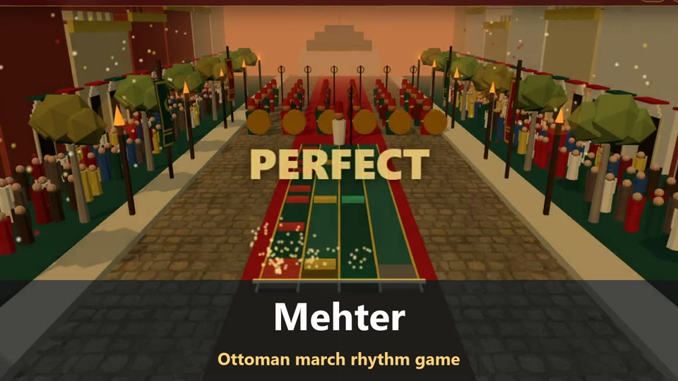
  </a>
</p>

<p align="center">
  <a href="https://furkiozknn.github.io/mehter/"></a>
</p>

<p align="center">
  
  
  <a href="LICENSE"></a>
  
</p>

<!-- portals:start -->
<p align="center">
  Also on: <a href="https://furkiozknn.itch.io/mehter"><strong>itch.io</strong></a>
</p>
<!-- portals:end -->

<p align="center">
  <strong>A 3D rhythm march down an old Ottoman parade avenue: the mehter band walks towards you while notes roll down four lanes for the davul, kös, zurna and zil. Hit them on the beat and keep the band's spirit up.</strong>
</p>

<p align="center">
  <sub>Watch the promo: <a href="https://github.com/Furkiozknn/social-videos/releases/download/promo-2026-10/2026-10-28-mehter-en.mp4">EN</a> &middot; <a href="https://github.com/Furkiozknn/social-videos/releases/download/promo-2026-10/2026-10-28-mehter-tr.mp4">TR</a></sub>
</p>

<!-- gameplay gif -->

## Features

- **Four lanes, four instruments:** Davul, kös, zurna and zil on `D` `F` `J` `K` (rebindable) or four touch zones, with long sustain holds required for the zurna.
- **Six songs across three difficulties:** From Düyek March at 96 BPM to March of Victory at 176 BPM in Easy, Normal and Hard, built from authentic usul rhythm patterns (düyek, sofyan, semai, nevbet, devr and zafer).
- **Precision audio-clock timing:** Music synthesised and scheduled on the Web Audio API clock, judging hits as Perfect within 45 ms and Good within 110 ms, with score multipliers (x2 at 10, x3 at 25, x4 at 50) and an interactive input calibration tool.
- **Flawless automated bot testing:** The `?auto` bot plays through all 6 songs; on the final song it hit all 907 notes perfectly for an S grade with 0 JS errors, both procedurally and with optional assets.
- **Ultra-lean web performance:** Runs at 60–61 fps on Intel UHD 620 graphics at 1280x720 with 29–31 draw calls (60,058–65,832 triangles) from a single `index.html` using Three.js r170, with an optional 1.75 MB CC0 asset pass.

## How to play

> [!TIP]
> **Goal:** Hit the notes on the beat and keep the band's spirit above zero until the end of the song. A clean run earns an S grade.

1. **Watch the lanes:** Notes roll towards the gilded hit line in front of the marching band for the davul, kös, zurna and zil.
2. **Hit on the beat:** Press `D` `F` `J` `K` or tap the lane zones when a note reaches the line: **Perfect** within 45 ms, **Good** within 110 ms, otherwise a miss.
3. **Hold zurna notes:** Long zurna notes must be held until the tail crosses the line; releasing too early breaks the note.

<details>
<summary><b>Rules and scoring</b></summary>

- **Hold notes:** Releasing a zurna note too early breaks it.
- **Combos & multipliers:** Combos raise the score multiplier: x2 at 10, x3 at 25, x4 at 50.
- **Band spirit:** Band spirit drops on misses and rises on hits. If spirit reaches zero, the song ends early.
- **Results:** Results display a grade (S, A, B, C), a hit-timing histogram, and your best score per song and difficulty.
- **Calibration:** Open Calibration from the title screen, press Start, and tap a key or the Tap button on each metronome beat. The median offset is saved and subtracted from every hit judgement.

</details>

### Controls

| Action | Keyboard | Mouse / touch |
|---|---|---|
| Lanes (davul, kös, zurna, zil) | `D` `F` `J` `K` (rebindable in Settings) | Tap the four lane zones at the bottom |
| Pause / back | `P` / `Esc` | Pause button |
| Music / effects | `M` / `X` | Sound settings |
| Language | `L` | TR / EN button |
| Fullscreen | Settings | Settings |

- **Audio control:** Sound settings allow volume and mute adjustments.
- **Touch:** Four responsive touch zones at the bottom of the screen.
- **Persistence:** Settings (volumes, TR / EN, Low / High quality, key bindings and the calibration offset) are saved in `localStorage` under `arena.mehter.settings`; best results under `arena.mehter.best`. Turkish is the default language; phones start on the Low tier.

<details>
<summary><b>URL flags for testing</b></summary>

| Flag | Effect |
|---|---|
| `?auto` | The bot plays through all six songs (Normal) to the end |
| `?debug` | Draw calls, fps, triangles, state and JS errors on screen |
| `?sim=N` | Fast-forward N seconds of song time before the first frame, without rendering |
| `?low` | Shadows off, half the particles |
| `?noassets` | Skip the CC0 asset files and keep the procedural world and synthesised sounds |
| `?lang=en` / `?lang=tr` | Language |
| `?song=N` | Song index (0–5) for `?auto` and `?sim` |
| `?screen=…` | Open `settings`, `pause`, `select`, `calib` or `results` directly (for screenshots) |

In the browser console, `window.mehter.state()` returns the live state (including which assets loaded) and `window.mehterSim(seconds)` fast-forwards the current song.

</details>

## Screenshots

<table>
  <tr>
    <td width="33%">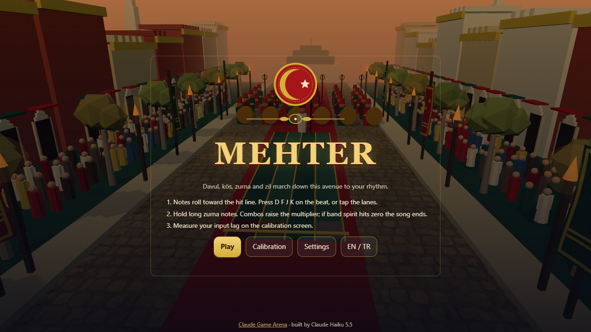<br><sub>Title screen</sub></td>
    <td width="33%">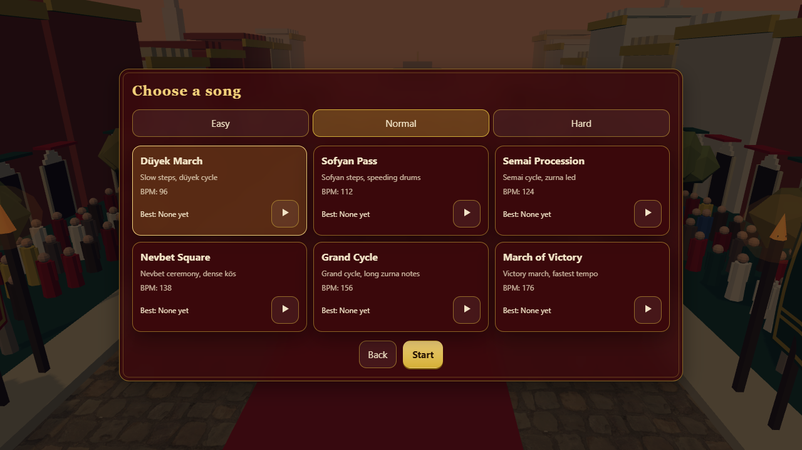<br><sub>Song select</sub></td>
    <td width="33%">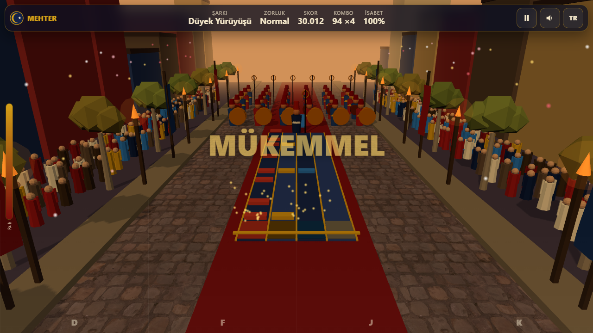<br><sub>The band on the cobbled avenue</sub></td>
  </tr>
  <tr>
    <td>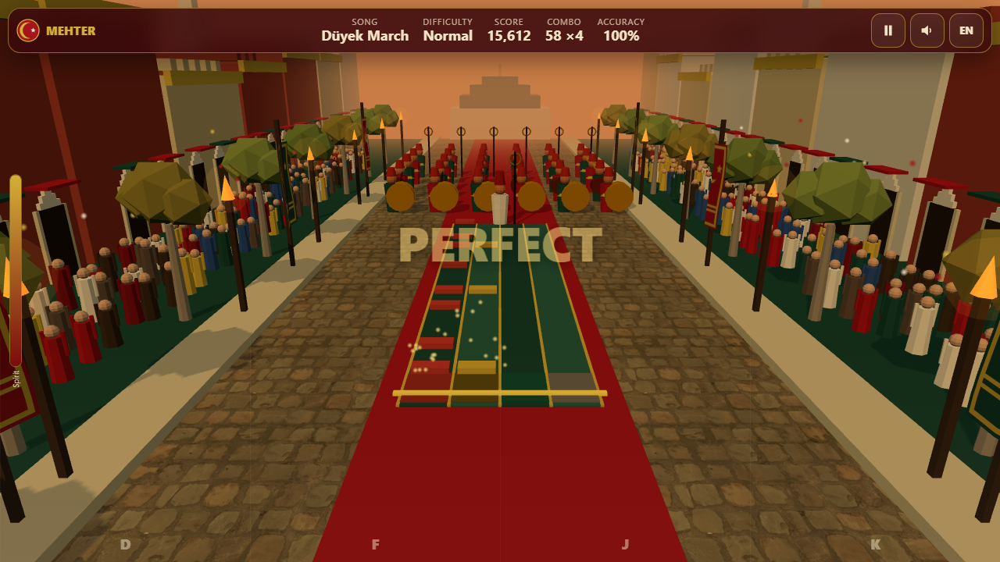<br><sub>A perfect hit</sub></td>
    <td>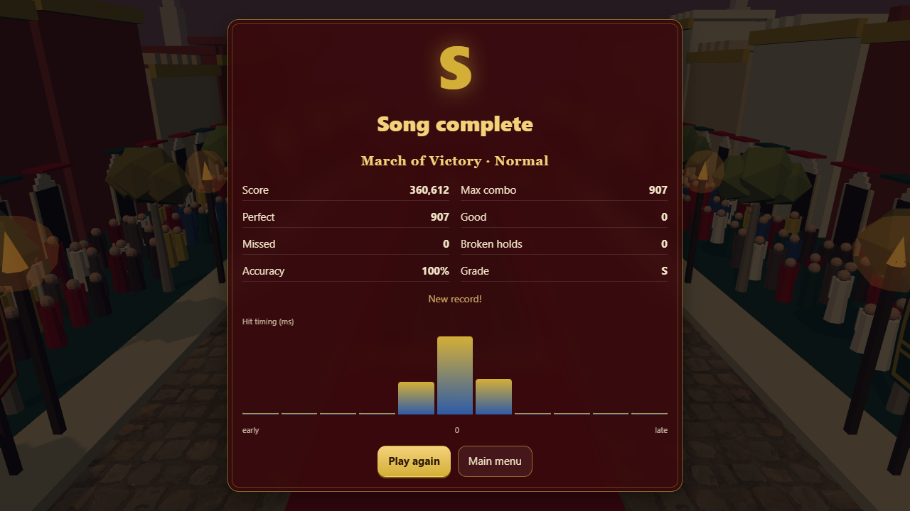<br><sub>S grade, 907 of 907 perfect</sub></td>
    <td>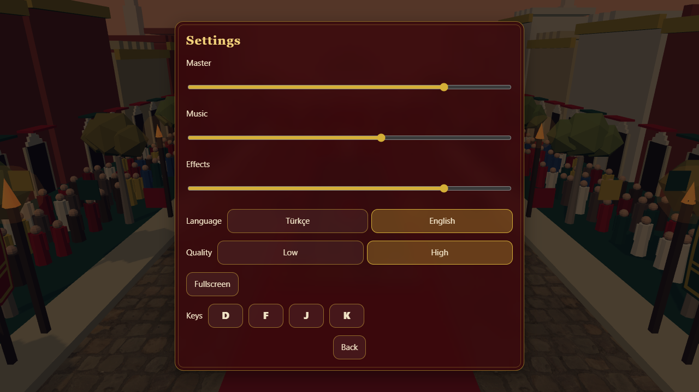<br><sub>Settings</sub></td>
  </tr>
</table>

## Redesign & Performance

**Art direction:** An Ottoman square at dusk, in crimson, gold and deep green on parchment stone, with torches that swell on every beat.

**Visual updates (gameplay rules, controls, and bot logic are untouched):**
- **Environment:** Arcaded houses with gold cornices and striped awnings, a mosaic floor drawn on canvas (replaced by the cobblestone asset when loaded), canvas-painted banners with crescent and star, a mosque dome and minarets closing the far end, and green gardens beside the carpet.
- **Band:** The drum stick strikes on davul notes, zil rings flash gold on zil hits, and the zurna sways while notes are held.
- **Look:** Gilded hit line glowing on the beat, gold and crimson sparks and confetti, crimson panels with gold frames, gilded buttons, tuğra-style flourish dividers, and Georgia headings (system font, zero download).
- **Language:** First visit follows the browser (Turkish for `tr` browsers, English otherwise).

**Measured on an Intel UHD 620 laptop (headless Chrome, 1280x720 with `?debug`, ~13 s into song 1):**
- Draw calls: 29 &rarr; 31
- Triangles: 60,058 &rarr; 65,832
- Page rAF: 60 fps (capped at display 61 fps)
- Automated verification: `?auto` bot completes all 6 songs with 0 JS errors (both with CC0 assets and with `?noassets`); on the final song it hits all 907 notes perfectly (S grade).

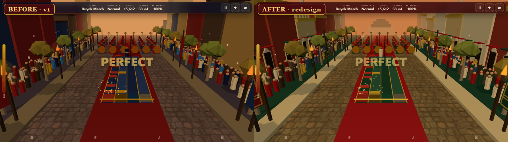

<details>
<summary><b>Phone layout and asset pass preview</b></summary>

<table>
  <tr>
    <td width="50%">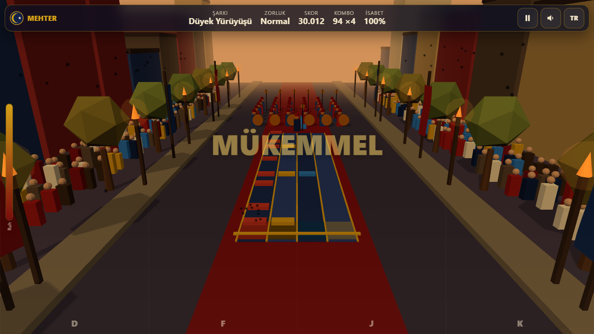<br><sub>Avenue, procedural</sub></td>
    <td width="50%"><br><sub>Avenue, with the asset pass</sub></td>
  </tr>
  <tr>
    <td>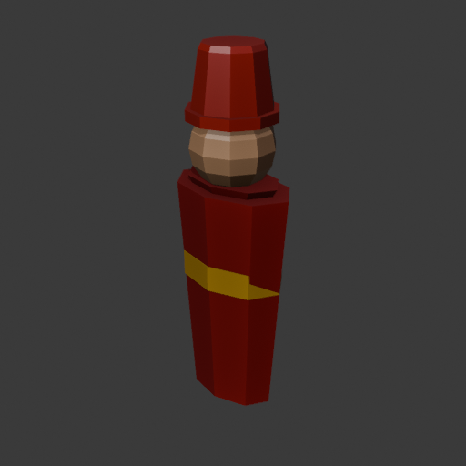<br><sub>Band figure model</sub></td>
    <td>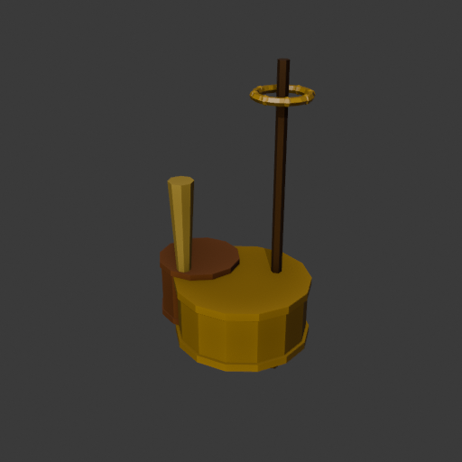<br><sub>Instrument models</sub></td>
  </tr>
</table>

<p align="center">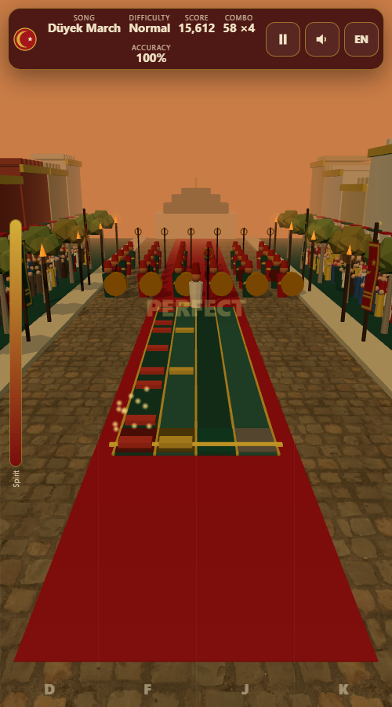<br><sub>On a phone</sub></p>

> [!NOTE]
> Tested on desktop emulation for the 500x900 phone layout (the HUD wraps accuracy to a second row). Songs are generated in code from authentic usul rhythm patterns (düyek, sofyan, semai, nevbet, devr and zafer); `?auto&sim=99999` fast-forwards all 6 songs without rendering with 0 JS errors and an S grade ([measurements & bot numbers](docs/assets.md#numbers)).

</details>

## Running locally

Serve the folder over HTTP (browsers block some features on `file://`):

```bash
python -m http.server 8000
```

Then open <http://localhost:8000/>.

## Made with Claude Code

Built by **Claude Haiku 5.5** with Claude Code from one prompt: [prompts/mehter.md](prompts/mehter.md); the shared arena rules were appended to that prompt. The avenue, crowd, trees, torches and notes are instanced or merged low-poly geometry with vertex colours, and the music, hit sounds and crowd cheers are synthesised with the Web Audio API.

An optional asset pass (about 1.75 MB, most of it the HDRI) adds Blender-built band figures (kaftan, sash, tall börk) and instruments (davul, kös, zurna, çevgen), a Poly Haven cobblestone texture for the road, a dusk HDRI on the High tier, and two Kenney sounds (a UI click and the results fanfare). They load after the first frame and the procedural versions stay as the fallback (`?noassets` skips them). Licences: [CREDITS.md](CREDITS.md); file list, sizes and fps before and after: [docs/assets.md](docs/assets.md). Model scripts: `assets/src/`.

<details>
<summary><b>Technical notes</b></summary>

- **Audio synthesis & clock (`Web Audio API`):** All instruments (davul, kös, zurna, zil) are synthesized in real time via Web Audio oscillators, custom noise buffers, and envelope shaping. Song notes are scheduled directly against the high-precision audio context clock, guaranteeing rock-solid hit judgement immune to main-thread frame jitter.
- **Procedural rhythms:** Song charts are algorithmically generated from traditional Ottoman usul rhythmic cycles (düyek, sofyan, semai, nevbet, devr, and zafer). Harder charts add notes from the same rhythm patterns so every chart matches the music.
- **Rendering & performance:** Three.js r170 with merged static geometry, instanced trees, crowd, and torch flames. Directional shadow maps, custom canvas-generated ground mosaics and banners, vertex-colored meshes, and soft-particle spark/confetti systems running at 60 fps on integrated Intel UHD 620 graphics.
- **Asset pipeline:** Progressive enhancement architecture where core gameplay and procedural visuals run instantly from `index.html`, dynamically streaming optional CC0 GLTF models, HDRI, and audio textures in the background.

</details>

### Claude Game Arena

Mehter is part of the **Claude Game Arena** series, where each game is built by a Claude model from one prompt.

[Hisar](https://furkiozknn.github.io/kale-savunmasi/) &middot; [Çay Ocağı](https://furkiozknn.github.io/cay-ocagi/) &middot; [Çini Ustası](https://furkiozknn.github.io/cini-ustasi/) &middot; [Martı](https://furkiozknn.github.io/marti/) &middot; [Kervan](https://furkiozknn.github.io/kervan/) &middot; [Dolmuş](https://furkiozknn.github.io/dolmus/) &middot; [Peri Golf](https://furkiozknn.github.io/peri-golf/) &middot; [Boğaz Vapuru](https://furkiozknn.github.io/bogaz-vapuru/) &middot; [Simit Fırını](https://furkiozknn.github.io/simit-firini/) &middot; [Karagöz](https://furkiozknn.github.io/karagoz/) &middot; [Lale Bahçesi](https://furkiozknn.github.io/lale-bahcesi/)

**Round 5:** [Kapadokya Balonu](https://furkiozknn.github.io/kapadokya-balonu/) &middot; [Ebru](https://furkiozknn.github.io/ebru/) &middot; [Kırkpınar](https://furkiozknn.github.io/kirkpinar/) &middot; [Çarşı Kaçışı](https://furkiozknn.github.io/carsi-kacisi/)

**Round 6:** [Topkapı Gecesi](https://furkiozknn.github.io/topkapi-gecesi/) &middot; [Hamsi](https://furkiozknn.github.io/hamsi/) &middot; [Pamukkale](https://furkiozknn.github.io/pamukkale/) &middot; [Mimar Sinan](https://furkiozknn.github.io/mimar-sinan/)

## License

MIT, see [LICENSE](LICENSE). Third-party assets are CC0, see [CREDITS.md](CREDITS.md).

Like the game? You can support new rounds on [Buy Me a Coffee](https://buymeacoffee.com/furkiozkann). The game stays free.
